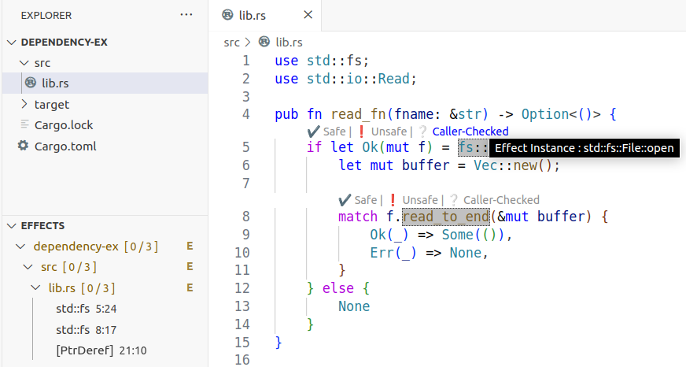

# Cargo Scan

Cargo Scan is a tool for auditing Rust crates.



<div align="center">

[Auditing Rust Crates Effectively - ESOP26](https://web.cs.ucdavis.edu/~cdstanford/doc/2026/ESOP26.pdf)


⚠️ Cargo Scan is under development. Some interfaces may be subject to change.

</div>

## Quick-start

Make sure you have [Rust](https://www.rust-lang.org/tools/install) installed first, then:

1. Clone this repository;
2. Run `cargo build`;
3. Follow the instructions under "Install the VSCode Extension" below. (Recommended)

For non-interactive use cases or if you wish to use Cargo Scan programmatically to incorporate it into other projects:

4. Follow the instructions under "Using the CLI" below.

## Install the VSCode Extension (Recommended)

1. Build the extension by running `make` in the `editor-plugin` directory. This will produce a `.vsix` file in that location.
2. Launch VSCode and install the extension from the `.vsix` file:
    - Press `Ctrl + Shift + P` (Windows/Linux) or `Cmd + Shift + P` (macOS) to open the Command Palette.
    - Type "Extensions: Install from VSIX..." and select it.
    - Navigate to the folder where the .vsix file is located and open it.

The extension is automatically activated when a Rust package is detected in the workspace.

### Performing an audit in VSCode

Ensure that you have opened a directory containing a Rust crate in VSCode.
Theen, there are two types of audits you can perform with Cargo Scan in VSCode:
1. **Single Crate Audit:** This scans the currently open package for side effects (see below).
- To run a single crate audit type `cargo-scan: Audit Crate` in the Command Palette.
2. **Chain Audit:** This performs a full audit and also scans the transitive dependencies of the open package.
- To run a chain audit, create the chain by typing `cargo-scan: Create Chain` in the Command Palette and then perform the actual audit by running the command `cargo-scan: Audit Chain`.

The set of side effects that Cargo Scan identifies are shown in the Effects view of the Explorer side bar.

### I'm seeing something about "effects" - what's a side effect?

Basically, it represents some behavior of a function that is not visible in its function signature - and that might or might not be dangerous (e.g., operating system calls, memory unsafety, or filesystem/network access). See [Wikipedia](https://en.wikipedia.org/wiki/Side_effect_(computer_science)) for a more general discussion. These are behaviors that you may want to look into further when auditing a crate.

## Using the CLI (Alternate)

You can use Cargo Scan non-interactively via the CLI. Run the following command (from this repository) provided with a path to any crate's source code you want to scan. For example if you want to run on the crate with source code `data/test-packages/permissions-ex`:
```
cargo run --bin scan data/test-packages/permissions-ex
```

This returns in CSV format as a list of side effects, one per line.
The beginning of the line gives the crate name, the function body and callee that contains the effect, and the effect type or pattern that it matches.
The last four items on each line give the directory, file, line, and column where the effect occurs.
Example output:
```
$ cargo run --bin scan data/packages/rand
    Finished `dev` profile [unoptimized + debuginfo] target(s) in 0.14s
     Running `target/debug/scan data/packages/rand`
crate, fn_decl, callee, effect, dir, file, line, col
rand, rand::distributions::other::<Standard as Distribution<char>>::sample, core::char::from_u32_unchecked, [UnsafeCall], data/packages/rand/src/distributions, other.rs, 94, 17
rand, rand::distributions::other::<Alphanumeric as DistString>::append_string, alloc::string::String::as_mut_vec, [UnsafeCall], data/packages/rand/src/distributions, other.rs, 136, 27
...
rand, rand::distributions::uniform::<Uniform<char> as super::DistString>::append_string, core::char::methods::len_utf8, [FnPtrCreation], data/packages/rand/src/distributions, uniform.rs, 860, 50

num_effects, total, loc_lb, loc_ub, macros, loc_lb, loc_ub, conditional_code, loc_lb, loc_ub, skipped_calls, loc_lb, loc_ub, skipped_fn_ptrs, loc_lb, loc_ub, skipped_other, loc_lb, loc_ub, unsafe_trait, loc_lb, loc_ub, unsafe_impl, loc_lb, loc_ub, pub_fns, pub_fns_with_effects, pub_total_effects, audited_fns, audited_loc
12, 25, 8708, 8708, 127, 1117, 1185, 21, 2410, 2410, 0, 0, 0, 0, 0, 0, 25, 3, 25, 0, 0, 0, 0, 0, 0, 53, 23, 52, 58, 540
```

If you don't want the totals at the bottom, suppress them with the `-s` option.

For additional usage options, run `--help`:
```
cargo run --bin scan -- --help
```

## Additional information

### Repository structure

Most of the source code of Cargo Scan can be found in `src/`, with miscellaneous data and scripts in `data/` and `scripts/`.
The VS Code extension is developed in `lang_server` and `editor-plugin`.

### Running the unit tests

- Run `cargo test` to run Rust unit tests.

- Run `make test` to re-run the tool on all our test packages, whose results are in `data/results` and placed under version control to check for any regressions.

- See the `Makefile` for other targets and options!

### Contributors and acknowledgments

Cargo Scan is open source.
Current maintainers are [Caleb Stanford](https://web.cs.ucdavis.edu/~cdstanford/) and [Lydia Zoghbi](https://github.com/lzoghbi).

Thank you to UC Davis PL and UC San Diego PLSysSec for past contributions, and to the National Science Foundation for support. For copyright information, see the `LICENSE`.

## Feedback

If you are using Cargo Scan for a project, let us know! We are open to new collaborations to improve the tool for your use case.

We welcome bug reports, suggestions, and pull requests! Please raise an issue or send us an email.

## Citing this repository

If you want to cite this repository, please consider citing our paper at ESOP 2026:

- *Auditing Rust Crates Effectively.* Lydia Zoghbi, David Thien, Ranjit Jhala, Deian Stefan, and Caleb Stanford. Experience report at European Symposium on Programming (ESOP), part of the International Joint Conferences On Theory and Practice of Software (ETAPS), April 2026. ([PDF](https://web.cs.ucdavis.edu/~cdstanford/doc/2026/ESOP26.pdf))

You may also cite the repository directly:

- Cargo Scan: a tool for auditing Rust crates. Lydia Zoghbi, David Thien, Ranjit Jhala, Deian Stefan, and Caleb Stanford. GitHub repository (2024). [github.com/PLSysSec/cargo-scan](https://github.com/PLSysSec/cargo-scan)
